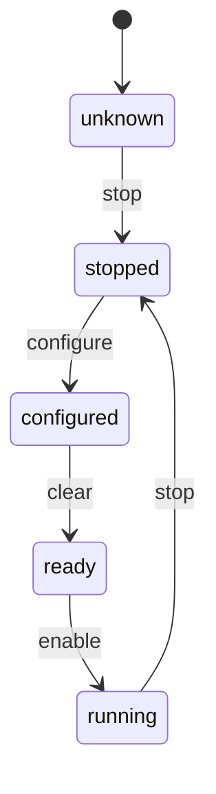

# Proving a peripheral initialization sequence

The second example is [TimerSequence.lean](../examples/hardware-contracts/HardwareContracts/TimerSequence.lean), in the same small `hardware_contracts` Lake dependency as the reload example. It demonstrates a practical driver policy: validate an entire initialization plan before writing any registers.

The timer must be stopped before configuration, configured before clearing its current count, and cleared before enabling:



`stop` is also permitted from every other state. All transitions missing from the specification are rejected. In particular, writing configuration while running, enabling before clearing, and treating an unknown initial state as already configured are forbidden. These are this driver's conservative sequencing rules; SysTick hardware does not itself enforce them.

## What the theorem proves

`Allowed` is the declarative specification. `next` and `check` are the executable validator. `SafeTrace` describes a complete sequence in which **every command** follows an allowed transition. The main theorem connects the implementation to the specification:

```lean
theorem check_sound (commands : List Command) (s final : State)
    (h : check s commands = some final) : SafeTrace s commands final
```

Its proof uses induction on the command list. An empty plan makes no transition. For a nonempty plan, `next_sound` proves the first transition is allowed, and the induction hypothesis proves the remaining trace is safe. This covers **any finite length**, rather than enumerating four-command plans. `no_live_configuration` and `enable_requires_ready` state two useful consequences of the allowed-transition rules.

`ApprovedPlan period commands` combines that trace proof with the original `SysTickConfig period` numeric contract. The `approve` function can only return a value after validating the reload bounds and the whole sequence; it uses `check_sound` to construct the sequencing proof. Both proof fields are erased during C generation. There are no added axioms or `sorry`s.

## Executing the plan

The C entry point is exported by `timerSequence` in [Smoke.lean](../examples/smoke/Smoke.lean), using `@[export lean_embedded_timer_sequence]`. That wrapper calls `HardwareContracts.TimerSequence.checkedReload` in `TimerSequence.lean`. The `@[expose] public section` in the contract module does not define a C entry point. See [C-to-Lean entry points](../README.md#c-to-lean-entry-points) for the complete startup path and the other examples.

The small C-facing demonstration accepts four command codes: `0 = stop`, `1 = configure`, `2 = clear`, `3 = enable`. For example:

| Commands | Result |
| --- | --- |
| stop, configure, clear, enable | accepted with a valid period |
| stop, configure, enable, configure | rejected: enable before clear, then a live configuration write |
| stop, configure, stop, enable | rejected: stopping invalidates the earlier setup |
| configure, stop, clear, enable | rejected: initial state is unknown |
| any code outside 0–3 | rejected |

`lean_embedded_timer_sequence` returns zero for rejection or the proved nonzero 24-bit reload for acceptance. [timer_sequence.c](../examples/smoke/timer_sequence.c) snapshots the commands, validates the complete snapshot, and only then executes those same commands. An invalid plan cannot partially stop or reconfigure the timer through this executor. The executor maps the commands to `CTRL = 0`, `LOAD = reload`, `VAL = 0`, and enabling with the processor clock, respectively. It leaves tick interrupts disabled for the test.

The hardware semantics come from **arm/ddi0553-latest, DDI0553 B.z p.290 §B11.1 and p.1857 §D1.2.242**: SysTick counts down when enabled; a word write to its current-value register clears it. The reload restrictions are explained in [the first proof example](proof-example.md).

## FVP verification and limits

Build and Run either existing `minimal` target set; the new example runs automatically. The `console` target sets also run it. The integration test:

- Exhausts all 256 four-command combinations over the four known commands. Exactly one is accepted.
- Checks twelve unknown-code cases and the seven period boundaries from the first example.
- Executes the valid plan against FVP SysTick and reads back the stopped state, reload, cleared current count, and final control bits.
- Tries every rejected four-command plan against the running timer and checks that LOAD and the writable CTRL bits are unchanged. It also checks rejection of an unknown code and an invalid period through the executor.

The expected output is `PASS: proved timer initialization sequence + FVP MMIO (256 plans)`. `scripts/verify-evidence.py --console` requires it for all four current ELF images.

The theorem covers the Lean state-machine model and validated plans. The Lean kernel/compiler/runtime, C ABI, command-to-register mapping, CMSIS definitions, and hardware model remain trusted. The C executor is an integration boundary, not a formally verified driver. Exclusive timer ownership and exclusion of concurrent register writers are required; the proof does not establish timing, interrupt behavior, or physical hardware correctness.

RTX normally owns SysTick. This bounded test runs after worker tests finish, locks the kernel, masks interrupts, and restores the saved LOAD/CTRL settings before resuming. Writing VAL restarts the tick phase, so it does not preserve elapsed time. A production driver should own a separate timer rather than borrow the RTOS tick.
